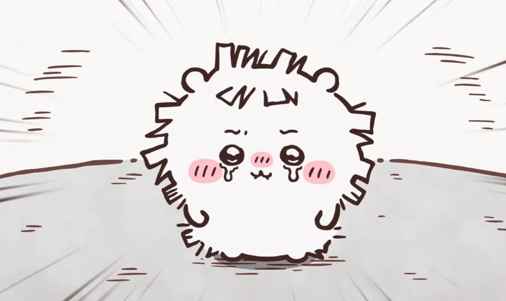

# 치이카와 메인 캐릭터

작가 나가노(ナガノ)의 만화 『치이카와(なんか小さくてかわいいやつ)』의 주요 캐릭터 요약.

## 주인공 3인방
- **치이카와**: 흰 곰 같은 작은 생명체. 소심하고 잘 울지만 착하고 성실함. 토벌·제초 일을 하며 자격시험(풀뽑기 검정)에 도전 중.
- **하치와레**: 머리에 하치와레(八割れ) 무늬가 있는 고양이. 긍정적이고 말을 잘함. 기타를 치며 노래하는 걸 좋아함.
- **우사기**: 노란 토끼. "우라!", "야하!" 같은 외침만 하는 자유분방한 성격. 운동신경과 일솜씨가 뛰어남.

## 주요 조연
- **모몽가**: 날다람쥐. 귀여움을 무기로 관심과 대접을 요구하는 제멋대로인 성격.
- **쿠리만쥬**: 밤만쥬 모습의 어른스러운 캐릭터. 술과 안주를 즐기며 "하-" 하고 한숨 쉬는 게 특징.
- **랏코**: 해달. 토벌 랭킹 최상위의 실력자로, 치이카와 일행이 동경하는 선배.
- **시사**: 오키나와 수호신 시사 모습의 캐릭터. 라멘 가게 '로-(郎)'에서 수습으로 일하는 성실파.
